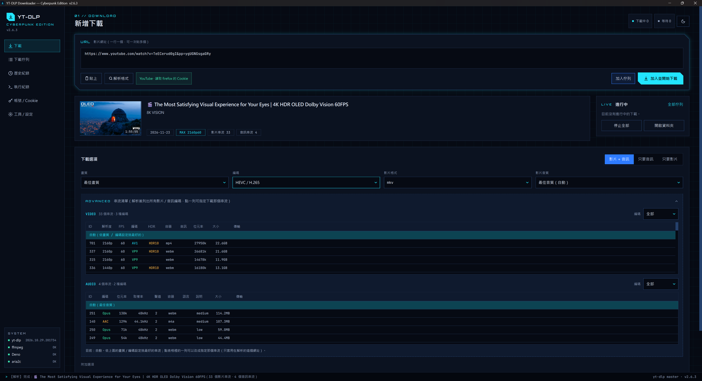
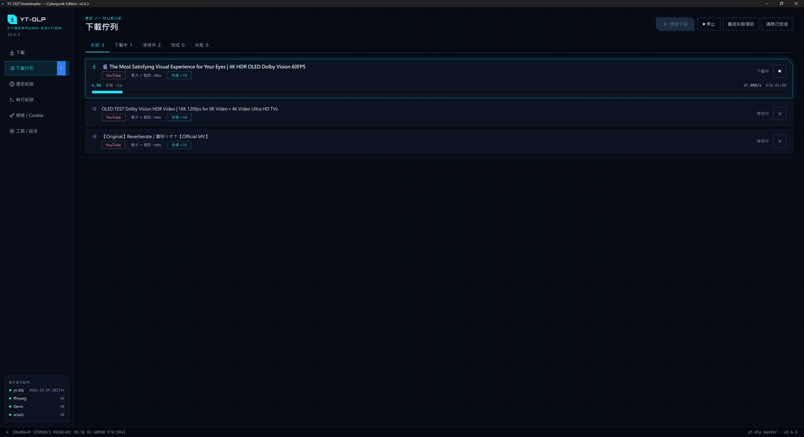
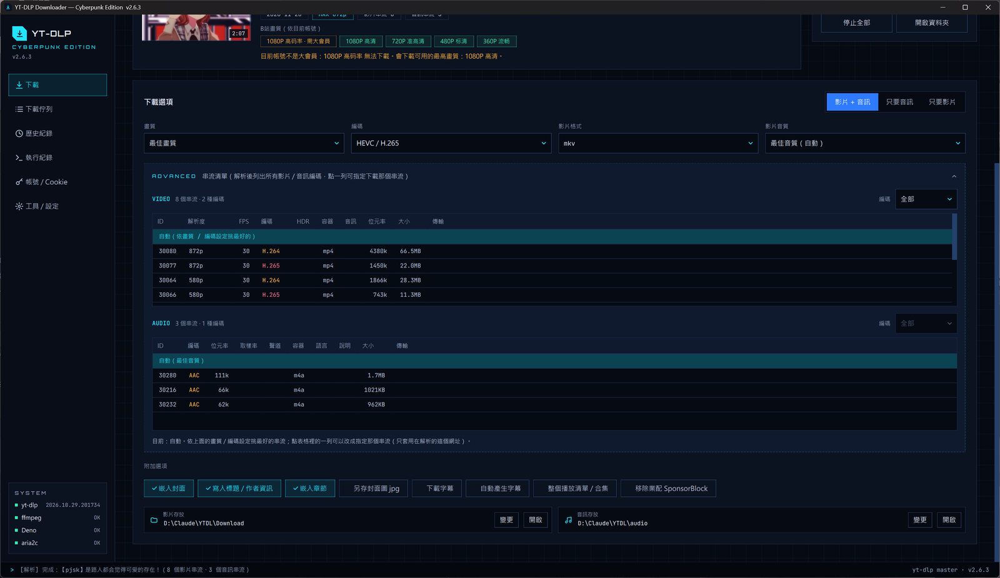
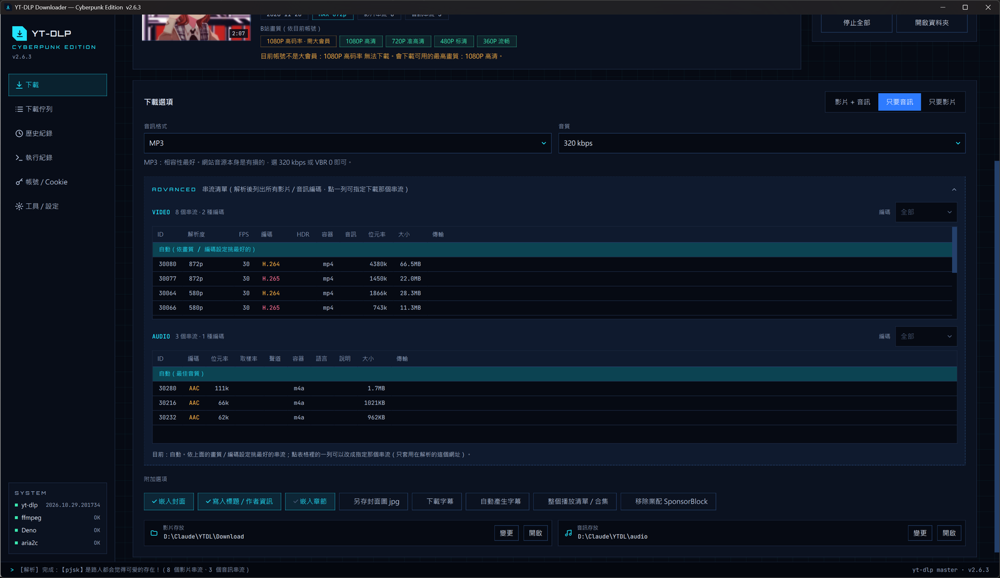
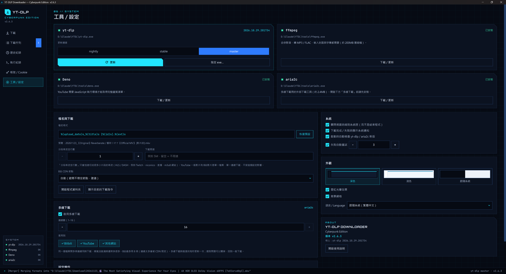

# YT-DLP Downloader — Cyberpunk Edition

[繁體中文](README.md) | [简体中文](README.zh-CN.md) | **English** | [日本語](README.ja.md)

A Windows desktop downloader built on [yt-dlp](https://github.com/yt-dlp/yt-dlp), with a cyberpunk-style interface made in PySide6.
Supports YouTube, Bilibili and the thousands of other sites yt-dlp supports.



## Features

- **Download**: video + audio / audio only / video only; choose quality, preferred codec (H.264 / AV1 / VP9 / HEVC) and container (mkv / mp4 / webm)
- **Audio**: MP3 / FLAC / M4A / Opus / WAV / original audio (no re-encoding)
- **Stream list**: after analyzing a URL, every video / audio stream is listed in a table (resolution, FPS, codec, HDR, bitrate, size); filter by codec and pick the exact stream to download
- **Download queue**: live progress, failure reasons with suggested fixes, automatic retries with increasing delays
- **Multi-connection downloads**: optional aria2c, several connections per file
- **Bilibili**
  - QR code login (logged-in accounts can download 1080P and above; VIP accounts get 4K / Hi-Res)
  - Shows which qualities are available / VIP only / login required
  - Pick episodes from multi-part videos
  - Automatically avoids unstable CDN nodes and switches nodes (resuming the download) when the connection keeps dropping
- **YouTube**: browser cookies or cookies.txt (members-only and age-restricted content)
- **Other**: download history, system tray, completion notifications, update check for yt-dlp / aria2c on startup, settings export / import, dark / light theme
- **Languages**: 繁體中文 / 简体中文 / English / 日本語, following the Windows display language by default

## Screenshots

> The screenshots show the Traditional Chinese interface; the language can be switched to English in the settings.

**Download queue: live progress of a multi-connection download**



**Bilibili: shows which qualities your account can download**



**Audio only: MP3 / FLAC and more, with every audio stream listed below**



**Tools / Settings: one-click tool downloads, multi-connection downloads, appearance and language**



## Requirements

- Windows 10 / 11 (64-bit)
- Python 3.10 or later (only needed to run from source; tick "Add python.exe to PATH" during installation)

## Installation

### Option 1: Download the exe (recommended)

No Python needed.

1. Download the latest `YTDL_GUI-vX.X.X.zip` from [Releases](../../releases/latest).
2. Extract it to any folder (for example `D:\YTDL`). **Don't** run it from inside the zip.
3. Open `YTDL_GUI.exe`.
4. On first use, open "Tools / Settings" on the left and download yt-dlp, ffmpeg and Deno with one click (aria2c is optional).

> Windows may show "Windows protected your PC" because the exe isn't digitally signed. Click "More info → Run anyway".

### Option 2: Run from source

1. Download or clone this repo and open a Command Prompt in its folder.
2. First run: create a separate Python environment and install the dependencies
   ```bat
   python -m venv .venv
   .venv\Scripts\pip install -r requirements.txt
   ```
3. Start the app (use this line every time from now on)
   ```bat
   .venv\Scripts\pythonw YTDL_GUI.pyw
   ```
4. In the app, open "Tools / Settings" on the left and download the tools you need with one click:
   - **yt-dlp** (required)
   - **ffmpeg**: needed for merging video and audio, converting to MP3 / FLAC, and embedding thumbnails and subtitles
   - **Deno**: YouTube needs it to provide the full list of qualities
   - **aria2c** (optional): multi-connection downloads

If the app doesn't open or closes immediately, start it with `python` instead of `pythonw`. The Command Prompt will then show the error, which is also written to `error.log`:

```bat
.venv\Scripts\python YTDL_GUI.pyw
```

To switch the interface to English, go to "Tools / Settings › Appearance › Language". The detailed manual, [`使用說明.txt`](使用說明.txt), is in Traditional Chinese only.

## Building a single exe

After setting up `.venv` as above, build with PyInstaller (the translations and Qt's built-in translations are bundled into the exe):

```bat
.venv\Scripts\pip install pyinstaller
.venv\Scripts\pyinstaller --noconfirm --clean --windowed --onefile ^
    --name YTDL_GUI --icon app.ico --workpath build --distpath dist ^
    --add-data ".venv\Lib\site-packages\PySide6\translations\qtbase_zh_TW.qm;PySide6\translations" ^
    --add-data ".venv\Lib\site-packages\PySide6\translations\qtbase_zh_CN.qm;PySide6\translations" ^
    --add-data ".venv\Lib\site-packages\PySide6\translations\qtbase_ja.qm;PySide6\translations" ^
    --add-data "lang;lang" ^
    YTDL_GUI.pyw
```

This produces `dist\YTDL_GUI.exe`. Keep the exe in the same folder as `yt-dlp.exe` and the `fonts` folder.

Pushing a tag that starts with `v` (for example `v2.6.4`) makes GitHub Actions build the exe and create a Release automatically (see `.github/workflows/build.yml`).

## Project structure

```
YTDL_GUI.pyw      Main program (UI and download flow)
ytdl_core.py      Core logic: download commands, Bilibili login, tool downloads
ui_theme.py       Cyberpunk theme: colors, fonts, icons, custom-drawn widgets
i18n.py           Multi-language support
lang/             Translation files (key = Traditional Chinese original)
fonts/            Orbitron, JetBrains Mono (SIL Open Font License)
yt_dlp_plugins/   yt-dlp plugins: BiliCDNFix (Bilibili CDN node fix), ChromeCookieUnlock
```

Files created only when the app runs (listed in `.gitignore`, never uploaded): `settings.json`, `history.db`, `cookies/`, `tools/`, `Download/`, `audio/`, `.venv/`.

## Translations

Translation files live in `lang/` (`zh_CN.json`, `en.json`, `ja.json`). Each key is the original Traditional Chinese text and each value is its translation.
Any text without a translation is shown in Traditional Chinese. Improvements to the translations are welcome.

## Privacy

Login data (Bilibili login cookies, cookies.txt) is stored only in the app's folder on your PC and is never sent anywhere other than yt-dlp and the sites themselves.
**Never upload `cookies/`, `settings.json` or any cookies.txt to the internet** — they are equivalent to your logged-in accounts.

## License

The code in this project is licensed under the [MIT License](LICENSE).

Third-party components:

| Component | License | Notes |
|---|---|---|
| [yt-dlp](https://github.com/yt-dlp/yt-dlp) | Unlicense | Downloaded by the app at runtime, not included in the repo |
| [FFmpeg](https://ffmpeg.org/) | LGPL / GPL | Downloaded by the app at runtime, not included in the repo |
| [Deno](https://deno.com/) | MIT | Downloaded by the app at runtime, not included in the repo |
| [aria2](https://github.com/aria2/aria2) | GPL-2.0 | Downloaded by the app at runtime, not included in the repo |
| [PySide6](https://doc.qt.io/qtforpython/) | LGPL-3.0 | Installed via pip |
| Orbitron, JetBrains Mono fonts | SIL OFL 1.1 | License files in `fonts/` |
| [yt-dlp-ChromeCookieUnlock](yt_dlp_plugins/ChromeCookieUnlock) | MIT | License file in that folder |

## Disclaimer

This tool is intended for personal backup and learning only. Follow each site's terms of service and copyright law when downloading,
and do not download or distribute content you don't have the right to access.
