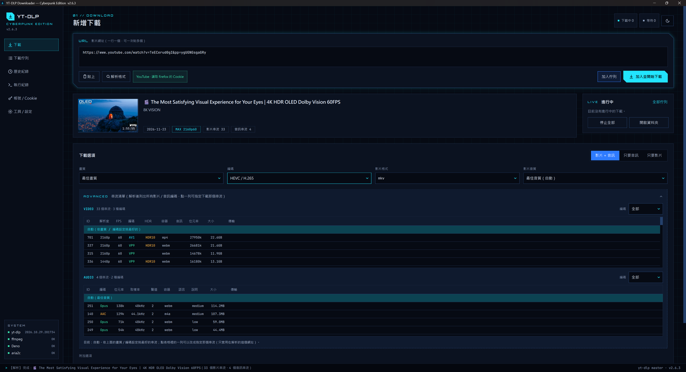
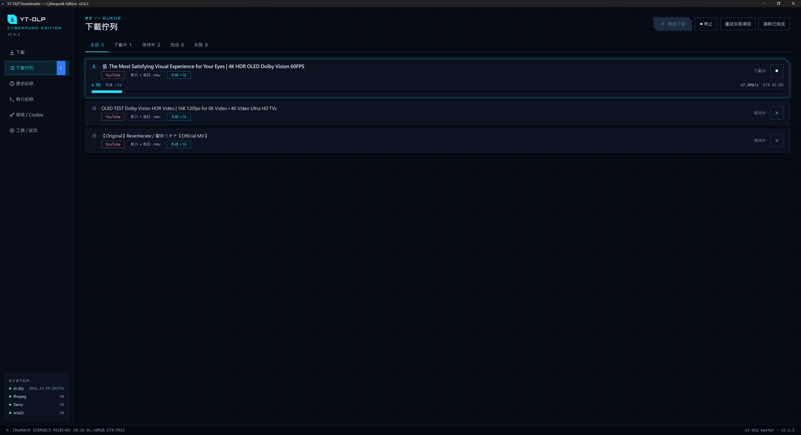
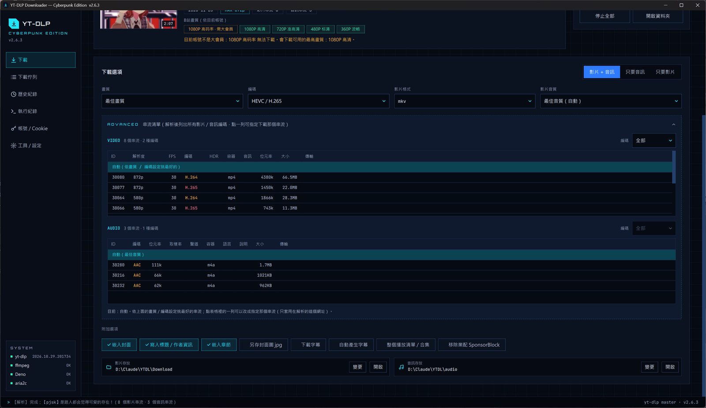
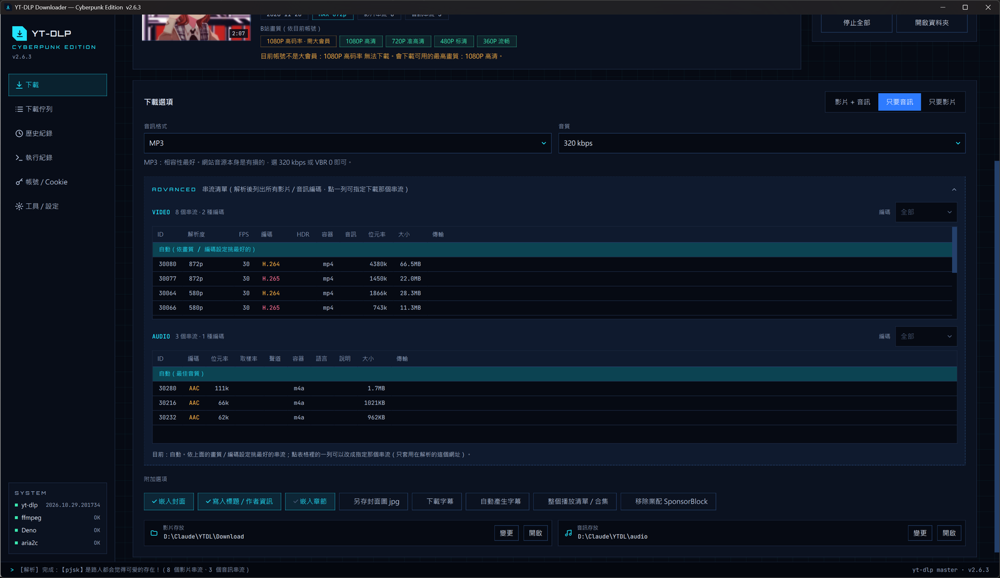
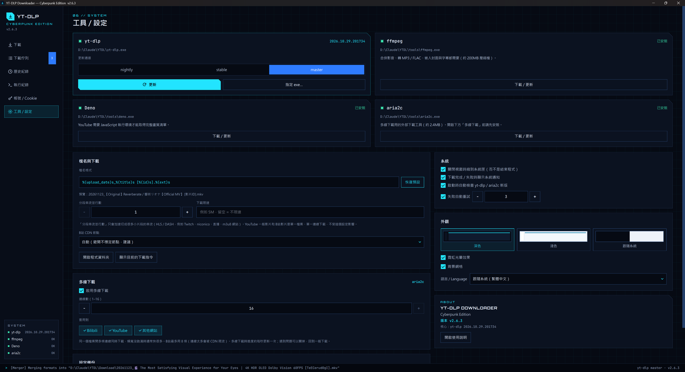

# YT-DLP Downloader — Cyberpunk Edition

[繁體中文](README.md) | **简体中文** | [English](README.en.md) | [日本語](README.ja.md)

以 [yt-dlp](https://github.com/yt-dlp/yt-dlp) 为核心的 Windows 桌面下载器，使用 PySide6 制作的 Cyberpunk 风格界面。
支持 YouTube、Bilibili 以及 yt-dlp 支持的上千个网站。



## 功能

- **下载**：视频 + 音频 / 仅音频 / 仅视频；可选画质、编码偏好（H.264 / AV1 / VP9 / HEVC）、容器（mkv / mp4 / webm）
- **音频**：MP3 / FLAC / M4A / Opus / WAV / 原始音频（不转码）
- **流列表**：解析后用表格列出所有视频 / 音频流（分辨率、FPS、编码、HDR、码率、大小），可按编码筛选并指定下载
- **下载队列**：实时进度、失败原因与建议、失败自动重试（间隔逐渐变长）
- **多线程下载**：可选用 aria2c，同一个文件开多条连接
- **Bilibili**
  - 二维码扫码登录（登录后可下载 1080P 以上，大会员可下载 4K / Hi-Res）
  - 解析时标出每种画质是「可以下载 / 需大会员 / 需登录」
  - 视频选集（分 P）勾选下载
  - CDN 节点自动避开不稳定节点，连续断开时自动换节点续传
- **YouTube**：浏览器 Cookie 或 cookies.txt（会员、年龄限制内容）
- **其他**：下载历史、系统托盘、完成通知、启动时检查 yt-dlp / aria2c 新版本、设置导出 / 导入、深色 / 浅色主题
- **多语言**：繁體中文 / 简体中文 / English / 日本語，默认跟随 Windows 显示语言

## 截图

> 截图为繁体中文界面，界面语言可在设置中切换为简体中文。

**下载队列：多线程下载的实时进度**



**Bilibili：标出每种画质能否下载（按当前账号）**



**仅音频：MP3 / FLAC 等格式，下方列出所有音频流**



**工具 / 设置：一键下载工具、多线程下载、外观与语言**



## 系统要求

- Windows 10 / 11（64 位）
- Python 3.10 以上（只有从源代码运行才需要；安装时勾选「Add python.exe to PATH」）

## 安装与运行

### 方法一：直接下载 exe（推荐）

不需要安装 Python。

1. 到 [Releases](../../releases/latest) 下载最新版的 `YTDL_GUI-vX.X.X.zip`。
2. 解压到任意文件夹（例如 `D:\YTDL`），**不要**直接在压缩包里运行。
3. 打开 `YTDL_GUI.exe`。
4. 第一次使用时，到左侧「工具 / 设置」一键下载 yt-dlp、ffmpeg、Deno（aria2c 可选）。

> Windows 可能会弹出「Windows 已保护你的电脑」：这是因为 exe 没有数字签名，点「更多信息 → 仍要运行」即可。

### 方法二：从源代码运行

1. 下载或 clone 这个 repo，在文件夹里打开命令提示符。
2. 第一次运行：创建独立的 Python 环境并安装依赖
   ```bat
   python -m venv .venv
   .venv\Scripts\pip install -r requirements.txt
   ```
3. 启动程序（以后每次都用这行）
   ```bat
   .venv\Scripts\pythonw YTDL_GUI.pyw
   ```
4. 在程序左侧「工具 / 设置」中一键下载需要的工具：
   - **yt-dlp**（必需）
   - **ffmpeg**：合并音视频、转 MP3 / FLAC、嵌入封面与字幕都需要它
   - **Deno**：YouTube 需要它才能获取完整的画质列表
   - **aria2c**（可选）：多线程下载

如果程序打不开或闪退，改用 `python` 启动（不是 `pythonw`），命令提示符会显示错误信息；错误也会写入 `error.log`：

```bat
.venv\Scripts\python YTDL_GUI.pyw
```

界面语言可在「工具 / 设置 › 外观 › 语言 / Language」切换为简体中文。详细操作说明见 [`使用說明.txt`](使用說明.txt)（繁体中文）。

## 打包成单个 exe

先按上面的步骤创建好 `.venv`，再用 PyInstaller 打包（翻译文件与 Qt 内置翻译会一起打包进 exe）：

```bat
.venv\Scripts\pip install pyinstaller
.venv\Scripts\pyinstaller --noconfirm --clean --windowed --onefile ^
    --name YTDL_GUI --icon app.ico --workpath build --distpath dist ^
    --add-data ".venv\Lib\site-packages\PySide6\translations\qtbase_zh_TW.qm;PySide6\translations" ^
    --add-data ".venv\Lib\site-packages\PySide6\translations\qtbase_zh_CN.qm;PySide6\translations" ^
    --add-data ".venv\Lib\site-packages\PySide6\translations\qtbase_ja.qm;PySide6\translations" ^
    --add-data "lang;lang" ^
    YTDL_GUI.pyw
```

会生成 `dist\YTDL_GUI.exe`。exe 需要和 `yt-dlp.exe`、`fonts` 文件夹放在同一个文件夹里。

推送 `v` 开头的标签（例如 `v2.6.4`）时，GitHub Actions 会自动打包并创建 Release（见 `.github/workflows/build.yml`）。

## 项目结构

```
YTDL_GUI.pyw      主程序（界面与下载流程）
ytdl_core.py      下载命令、Bilibili 登录、工具下载等核心逻辑
ui_theme.py       Cyberpunk 主题：配色、字体、图标、自绘控件
i18n.py           多语言
lang/             翻译文件（key = 繁体中文原文）
fonts/            Orbitron、JetBrains Mono（SIL Open Font License）
yt_dlp_plugins/   yt-dlp 插件：BiliCDNFix（B站 CDN 节点修正）、ChromeCookieUnlock
```

运行后才会生成的文件（已列在 `.gitignore`，不会上传）：`settings.json`、`history.db`、`cookies/`、`tools/`、`Download/`、`audio/`、`.venv/`。

## 翻译

翻译文件在 `lang/`（`zh_CN.json`、`en.json`、`ja.json`），key 是繁体中文原文，value 是译文。
找不到翻译的句子会显示繁体中文原文。欢迎改进翻译。

## 隐私

登录数据（Bilibili 登录 Cookie、cookies.txt）只保存在本机的程序文件夹中，除了 yt-dlp 与各网站之外不会发送到其他地方。
**请不要把 `cookies/`、`settings.json` 或任何 cookies.txt 上传到网上**——它们等同于你的账号登录状态。

## 许可证

本项目代码以 [MIT License](LICENSE) 授权。

第三方组件：

| 组件 | 许可证 | 说明 |
|---|---|---|
| [yt-dlp](https://github.com/yt-dlp/yt-dlp) | Unlicense | 运行时由程序下载，不包含在 repo 中 |
| [FFmpeg](https://ffmpeg.org/) | LGPL / GPL | 运行时由程序下载，不包含在 repo 中 |
| [Deno](https://deno.com/) | MIT | 运行时由程序下载，不包含在 repo 中 |
| [aria2](https://github.com/aria2/aria2) | GPL-2.0 | 运行时由程序下载，不包含在 repo 中 |
| [PySide6](https://doc.qt.io/qtforpython/) | LGPL-3.0 | 通过 pip 安装 |
| Orbitron、JetBrains Mono 字体 | SIL OFL 1.1 | 许可证文件见 `fonts/` |
| [yt-dlp-ChromeCookieUnlock](yt_dlp_plugins/ChromeCookieUnlock) | MIT | 许可证文件见该文件夹 |

## 免责声明

本工具仅供个人备份与学习使用。下载内容时请遵守各网站的服务条款与著作权法规，
不要下载或传播你无权获取的内容。
